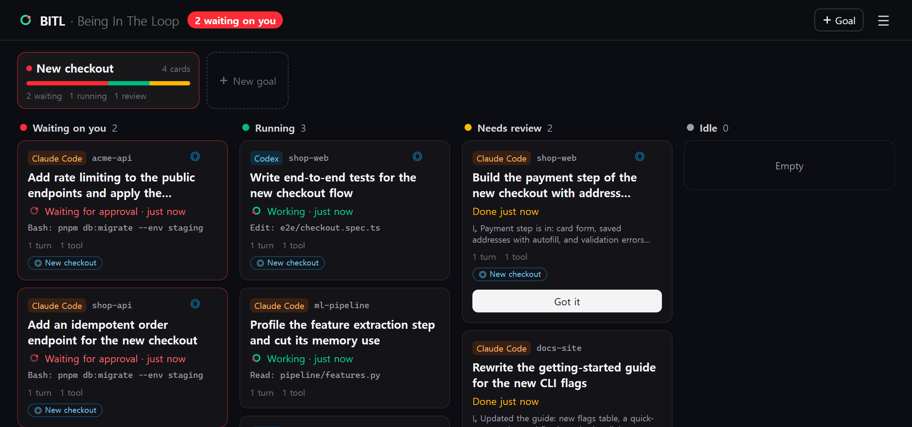

<p align="center">
  
</p>

<h1 align="center">BITL — Being In The Loop</h1>

<p align="center">
  <b>Stay in the loop with every AI coding agent you run.</b><br>
  Claude Code · Codex · Antigravity
</p>

<p align="center">
  <a href="LICENSE"></a>
  <a href="https://www.npmjs.com/package/@usebitl/cli"></a>
</p>

<p align="center"></p>

When several agents work for you at once, each one lives in its own terminal and it's easy to lose the big picture: which are still working, what you asked each of them to do, what they've finished, and how far along the whole thing is. BITL gives you one live view of every session you've started.

- **Every session at a glance**: running (with what it's doing right now, like `Bash: pnpm test`), waiting on you (a permission prompt or a question), or done with the last answer right on the card.
- **Goals**: group sessions under what you're actually trying to ship ("New checkout"). See how many are waiting, running or done, or show only that goal's cards.
- **The story of each session**: every prompt you gave and what came back, readable full screen, so you can catch up on what an agent did while you were away.
- Sessions that are already running show up too. No wrapper and no change to how you start your agents. BITL listens to their hooks.

This is the **local edition**. It runs on your PC (`127.0.0.1` only), needs no account, and keeps everything in a local SQLite file.

## Quick start

Requires Node.js 22.5 or later.

```sh
npx @usebitl/cli start            # starts the board; open the "Connect a browser" link it prints
npx @usebitl/cli install claude   # in another terminal: add Claude Code hooks (a backup is made)
```

Now use Claude Code as usual, in any folder. Its sessions appear on the board.

`@latest` makes npx fetch the newest version even if an older one is cached or installed. To keep the `bitl` command around, use `npm install -g @usebitl/cli` and then run `bitl start`.

When a new version is out, the board and `bitl` commands show a one-line notice. To check, BITL asks the npm registry for the latest version once a day; nothing else is sent. Turn it off with `BITL_NO_UPDATE_CHECK=1`.

| Agent | Install | What BITL sees |
|---|---|---|
| Claude Code | `bitl install claude` | Prompts, tool use, permission prompts, questions, turn end, subagents |
| Codex | `bitl install codex` | Prompts, tool use, permission prompts, turn end. Trust the hooks once in Codex with `/hooks` |
| Antigravity | `bitl install antigravity` | Prompts, tool use, turn end. Approval waits in the CLI, but not yet in the IDE |

`bitl uninstall <agent>` removes only what BITL added. `bitl status` prints the board in your terminal.

## Never in your agent's way

Hooks run inside your agent, so they follow strict rules:

- They are async, write nothing to stdout, always exit 0, and use short timeouts.
- If the BITL server isn't running, events go into a queue (`~/.bitl/queue.jsonl`) and the hook returns right away. The queue is processed when the server starts.
- BITL never answers a prompt for you or holds one back. The terminal stays in control.

## Your content stays encrypted

Even on your own PC, the server only sees signals: event type, time, and the kind of wait.

- **Minimized in the hook.** Raw payloads, full tool inputs (the code an agent edits) and tool output are dropped. What's left is the tool name, a one-line summary, and the start of prompts and answers.
- **Encrypted per field** with AES-256-GCM before it leaves the hook. The session key is bound as AAD, and fields are padded to 32-byte blocks.
- **The server refuses plaintext.** A content field that isn't sealed is rejected.
- **Only your browser decrypts.** The key lives in `~/.bitl/key` and reaches a browser through the link `bitl start` prints. It sits after `#`, so it is never sent to the server. Delete the key and old records can't be read by anyone.

## How it works

```
agent hook ─▶ bitl-hook.mjs ─▶ normalize ─▶ minimize ─▶ encrypt ─▶ local server ─▶ SSE ─▶ browser (decrypts)
                                                                   (state machine on signals only)
```

```
packages/
  adapters/  hook scripts: normalize → minimize → encrypt → send (queue when the server is down)
  shared/    normalization, sealing, crypto, decryption, wire validation
  server/    Hono, state machine (signals only), SSE, SQLite store
  cli/       bitl start / install / uninstall / status / pair
  web/       React + Vite + Tailwind board (decrypts in the browser)
```

Data: `~/.bitl/bitl.db`, key: `~/.bitl/key`. You can override them with `BITL_HOME`, `BITL_PORT`, `BITL_HOST` and `BITL_KEY`. The raw event log (signals only, for debugging) is kept for 14 days (`BITL_EVENT_RETENTION_DAYS`); session and prompt history stays.

## From source

Requires Node.js 22.5 or later and pnpm.

```sh
pnpm install               # also builds the hook bundle (packages/adapters/dist)
pnpm start                 # builds the web UI and starts the server
pnpm bitl install claude
```

`pnpm test` and `pnpm typecheck` run the checks. For development, run `pnpm dev:server` and `pnpm dev:web` (web on http://localhost:5173, with `/api` proxied to 7777).

## On your phone

The local edition stays on one PC. [usebitl.com](https://usebitl.com) is the hosted version. It adds your phone, push notifications when an agent is waiting, and several PCs on one account, with the same end-to-end encryption.

The local edition is free and open source (AGPL-3.0). usebitl.com is free during beta; paid plans will be announced at least 30 days ahead.

## Contributing

Bug reports and ideas are welcome in [Issues](https://github.com/usebitl/bitl/issues). For anything bigger than a small fix, please open an issue first so we can agree on the approach before you write code.

Pull requests need a one-time [Contributor License Agreement](https://cla-assistant.io/usebitl/bitl). A bot asks you to sign it with your GitHub account when you open your first pull request. You keep the copyright to your work. The agreement lets BITL also use it under other licenses, for example in the hosted service at usebitl.com. The code in this repository stays under AGPL-3.0.

This repository is exported from BITL's main development repository. An accepted pull request is applied there and arrives here with the next export instead of being merged directly. Your authorship is kept in a `Co-authored-by` line.

## License

[GNU AGPL-3.0](LICENSE). If you run a modified version as a network service, you must offer its source to its users.

"BITL" and the BITL logo identify the service at usebitl.com. Please use a different name and logo for a fork you distribute.

---

## 한국어

**내가 실행한 AI 코딩 에이전트들의 흐름을 놓치지 않게.** Claude Code, Codex, Antigravity 의 모든 세션을 한 화면에서 봅니다.

- 세션마다 지금 하는 일, 나를 기다리는지(권한 요청·질문), 끝났는지와 마지막 답변
- 목표: 이루려는 일("새 결제 화면") 아래에 세션을 묶어, 몇 개가 실행 중·대기·완료인지 보고 그 목표만 걸러 보기
- 세션별 기록: 내가 준 지시와 돌아온 답을 화면 가득 — 자리를 비운 사이 무엇을 했는지 따라잡기
- 이미 실행 중인 세션도 hook 으로 잡으므로 에이전트를 실행하는 방법은 바뀌지 않습니다

이 저장소는 **로컬판**입니다. 내 PC 에서만(`127.0.0.1`) 돌고, 계정이 필요 없으며, 모든 기록을 PC 의 SQLite 파일에 둡니다.

```sh
npx @usebitl/cli start            # 보드 시작 → 출력되는 "브라우저 연결" 링크를 연다 (Node.js 22.5 이상)
npx @usebitl/cli install claude   # 다른 터미널에서: Claude Code hook 등록 (백업 생성)
```

- 새 버전이 나오면 보드와 `bitl` 명령에 한 줄로 알립니다. 하루 한 번 npm 레지스트리에 최신 버전만 묻고, 다른 것은 보내지 않습니다 (`BITL_NO_UPDATE_CHECK=1` 로 끄기).
- hook 은 에이전트를 막거나 느리게 하지 않습니다. 서버가 꺼져 있으면 이벤트를 `~/.bitl/queue.jsonl` 에 쌓고 바로 돌아갑니다.
- 질문·답변·명령은 PC 에서 암호화됩니다. 서버는 평문을 받지 않고, 키(`~/.bitl/key`)가 있는 브라우저만 내용을 봅니다.
- 휴대폰·푸시 알림·여러 PC 는 [usebitl.com](https://usebitl.com) 에서 쓸 수 있습니다 (베타 기간 무료, 유료 전환은 적어도 30일 전에 알립니다).

버그 제보와 아이디어는 [Issues](https://github.com/usebitl/bitl/issues) 에 남겨 주세요. 작은 수정보다 큰 변경은 코드를 쓰기 전에 이슈로 먼저 방향을 맞춰 주세요. 풀 리퀘스트는 처음 한 번 [기여자 라이선스 동의(CLA)](https://cla-assistant.io/usebitl/bitl) 가 필요합니다. 첫 PR 을 열면 봇이 GitHub 계정으로 동의를 요청합니다. 저작권은 기여자에게 남고, BITL 이 그 기여를 다른 라이선스로도(예: usebitl.com) 쓸 수 있게 됩니다. 이 저장소의 코드는 계속 AGPL-3.0 입니다. 이 저장소는 BITL 개발 저장소에서 내보낸 것이라, 받아들인 PR 은 개발 저장소에 반영된 뒤 다음 내보내기 때 들어옵니다 (직접 병합하지 않고, `Co-authored-by` 로 작성자를 남깁니다).

라이선스는 [GNU AGPL-3.0](LICENSE) 입니다. 고친 버전을 네트워크 서비스로 운영하면 그 이용자에게 소스를 제공해야 합니다. "BITL" 이름과 로고는 usebitl.com 서비스를 가리키므로, 배포하는 포크에는 다른 이름과 로고를 써 주세요.
